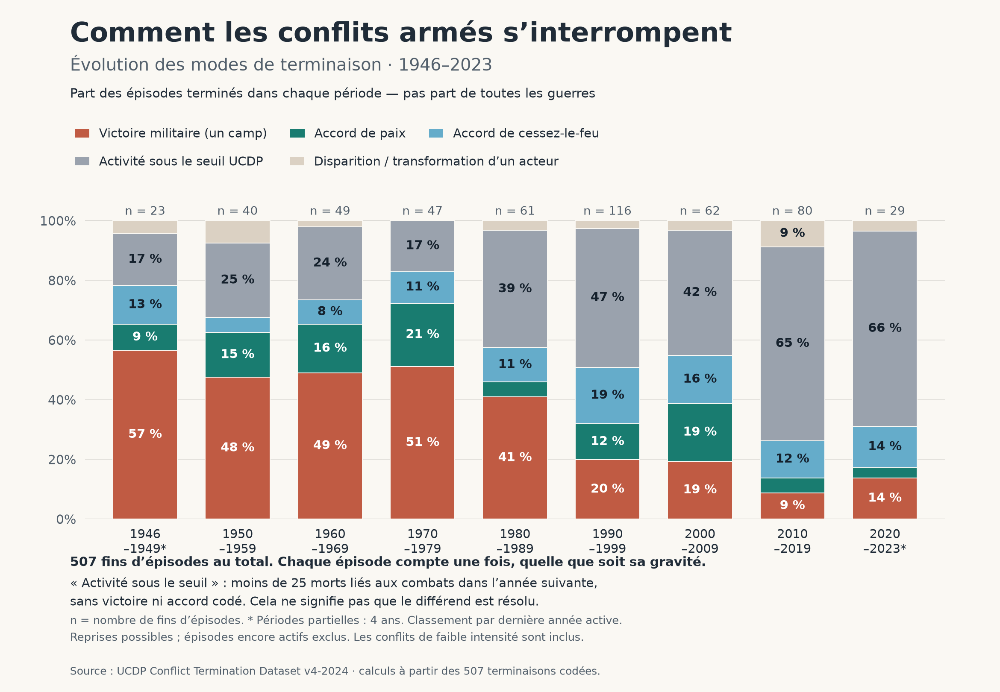

# Comment les conflits armés s’interrompent

Une visualisation reproductible des modes de terminaison des conflits armés,
à partir du **UCDP Conflict Termination Dataset, version 4-2024**.



## Reproduire le graphique

Prérequis : Git et [uv](https://docs.astral.sh/uv/getting-started/installation/).
Python 3.11 ou plus récent ; uv peut installer un interpréteur compatible.

```sh
git clone https://git.2027a.net/2027a/conflict-terminations.git
cd conflict-terminations
uv sync --locked
uv run --locked python reproduce.py
uv run --locked python -m unittest discover -s tests -v
```

Les données sont incluses : aucune requête vers UCDP n'est nécessaire pour
reproduire le graphique. La première installation télécharge les dépendances.
`uv.lock` fixe leurs versions. Aucun navigateur, compte ni secret n'est requis.

Pour écrire ailleurs sans modifier les résultats livrés :

```sh
uv run --locked python reproduce.py --output-dir /chemin/vers/resultats
```

Le script fonctionne aussi depuis un autre répertoire : il trouve les données
relativement à son propre emplacement, et non au répertoire courant.

## Contenu

- `reproduce.py` : extraction, agrégation, contrôle et dessin du graphique.
- `data/source.csv` : instantané du CSV original UCDP, non modifié.
- `data/provenance.json` : URL, date de récupération, version et empreinte SHA-256.
- `data/README.md` : source, attribution, licence et transformations.
- `output/fins-conflits-ucdp-1946-2023.csv` : les 507 fins d'épisodes retenues.
- `output/fins-conflits-par-periode.csv` : effectifs et pourcentages par période.
- `output/fins-conflits-evolution-1946-2023.png` : graphique prêt à partager.
- `tests/test_reproduce.py` : tests de reproduction et contrôles des résultats.
- `pyproject.toml` et `uv.lock` : environnement Python reproductible.

Les CSV produits utilisent le point-virgule et UTF-8 avec BOM, pour faciliter
leur ouverture dans les tableurs. Les identifiants et noms d'acteurs UCDP sont
conservés. Les libellés de catégories sont traduits en français.

## Ce que l'on compte

L'unité est une **fin d'épisode de conflit**, pas une guerre définitivement
résolue. Le script retient uniquement les lignes où `c_epterm == 1`.

Le fichier source comprend 2 752 observations annuelles, de 1946 à 2024.
Les 507 terminaisons codées vont de 1946 à 2023 : les observations finales ne
permettent pas encore de connaître l'activité de l'année suivante.

Chaque épisode compte une fois, indépendamment de sa gravité ou de sa durée.
Un même conflit peut reprendre et contribuer plusieurs épisodes. Les épisodes
encore actifs ne sont pas inclus dans ce dénominateur.

Les catégories du graphique regroupent les codes suivants :

- **Victoire militaire d'un camp** : codes 3 et 4, soit 151 épisodes.
- **Accord de paix** : code 1, soit 60 épisodes.
- **Accord de cessez-le-feu** : code 2, soit 67 épisodes.
- **Activité sous le seuil** : code 5, soit 209 épisodes.
- **Disparition ou transformation d'un acteur** : code 6, soit 20 épisodes.

Les observations sont classées par **dernière année active** (`year`), et non
par année de début du conflit ou par date d'un éventuel traité ultérieur.
Les décennies sont complètes, sauf 1946–1949 et 2020–2023, marquées d'un astérisque.

Pour chaque catégorie et période :

```text
part (%) = 100 × fins d'épisodes de cette catégorie / toutes les fins de la période
```

Les nombres au-dessus des barres donnent ce dénominateur. Les étiquettes internes
sont arrondies à l'entier et omises sous 8 % ; le CSV fournit toutes les valeurs.
Les effectifs de chaque période sont : 23, 40, 49, 47, 61, 116, 62, 80 et 29.

## Limites d'interprétation

- Le seuil UCDP du conflit armé est de 25 morts liés aux combats dans une année.
  La catégorie « guerre » au sens strict exige 1 000 morts dans l'année : ce
  graphique inclut donc aussi les conflits de faible intensité.
- Une baisse sous le seuil n'est pas une résolution du différend. Des violences
  peuvent continuer et reprendre au-dessus du seuil plus tard.
- Le code 6 peut correspondre à une transformation d'acteur, pas à la paix.
- Un accord peut consacrer une défaite militaire. Ce codage n'isole pas les
  effets causaux respectifs de la force et de la diplomatie.
- La fenêtre de codage est l'année finale active et la première année inactive.
  Un traité beaucoup plus tardif ne transforme pas rétroactivement une issue.
- Le graphique ne mesure ni la probabilité de gagner une guerre, ni la durée
  de la paix, ni les victimes, ni la part des conflits actuellement actifs.
- Les résultats des dernières périodes portent seulement sur les épisodes
  déjà interrompus ; ils ne préjugent pas de l'issue des conflits encore actifs.
- Les changements de composition des conflits peuvent contribuer aux tendances.
  Cette visualisation descriptive ne démontre pas une loi historique causale.

### Identifiants d'épisodes

Dans cet instantané, `c_epid` est parfois répété pour des épisodes distincts,
notamment aux Philippines et en République centrafricaine. Le script ne
supprime pas de lignes sur cette base. Il vérifie l'unicité de la paire
`conflict_id` + `year` parmi les 507 terminaisons.

La colonne exportée `id_episode_source_non_unique` conserve l'identifiant
original tout en signalant cette limite. Les dates de fin peuvent être
approximatives : leur code de précision UCDP est également conservé.

## Actualisation

Ce dépôt reproduit un **instantané déterminé**, pas une veille automatique.
L'empreinte de la source et les effectifs attendus sont vérifiés à l'exécution.
Pour adopter une nouvelle version, revoir les données, la documentation UCDP,
la provenance, les périodes, les contrôles et les résultats ensemble.
Ne pas remplacer le CSV en gardant silencieusement les anciennes conclusions.

## Sources et licences

Kreutz, Joakim (2010). *How and When Armed Conflicts End: Introducing the UCDP
Conflict Termination Dataset*. Journal of Peace Research, 47(2), 243–250.

<https://doi.org/10.1177/0022343309353108>

[Centre de téléchargement UCDP](https://ucdp.uu.se/downloads/)

[Manuel de codage v4-2024](https://ucdp.uu.se/downloads/monadterm/UCDPConflictTerminationDataset_v4_2024_Codebook.pdf)

Code : **MIT**. Données UCDP et sorties CSV/graphique : **CC BY 4.0**, avec
attribution à UCDP et citation de Kreutz. Voir [LICENSE](LICENSE) et
[data/README.md](data/README.md). UCDP n'a pas validé ni approuvé cette analyse.
